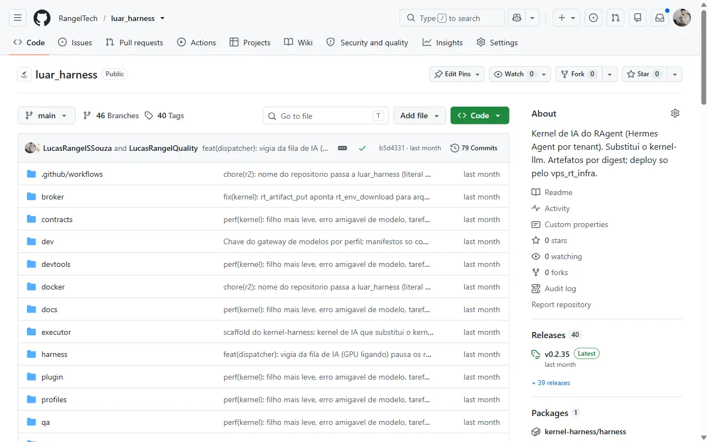

<!-- readme-padrao -->
# LUAR: execução dos agentes (harness)

> Execução dos agentes por skills (kernel-harness) e os trabalhadores Hermes (rt-hermes) usados pelo LUAR e pela IA dos produtos.



## O que é
Execução dos agentes por skills (kernel-harness) e os trabalhadores Hermes (rt-hermes) usados pelo LUAR e pela IA dos produtos.

Estado: **no ar**.

## Onde está no ar
- Sem endereço público próprio.

## Onde faz o deploy
Este repositório **só publica** o artefato (release com imagem e manifesto); **quem implanta é o `vps_rt_infra`**.

- Serviço `kernel-harness`: `gh workflow run deploy.yml --repo RangelTech/vps_rt_infra -f service=kernel-harness` (só validar: `-f dry_run=true`; voltar versão: `-f version=<tag-antiga>`)
- Serviço `rt-hermes`: `gh workflow run deploy.yml --repo RangelTech/vps_rt_infra -f service=rt-hermes` (só validar: `-f dry_run=true`; voltar versão: `-f version=<tag-antiga>`)

Os `.env` desses serviços são gerados do Infisical no momento do deploy (spec 57, seção 0A).

## Como funciona por dentro
Resumo acima; os detalhes estão nas notas técnicas (README anterior) abaixo e na spec 57.

## Segredos
Nenhum valor de segredo fica neste repositório. Os segredos dos serviços ficam no Infisical (mapa em `vps_rt_infra/scripts/infisical/mapa_envs.json`) e chegam à VPS gerados no deploy.

## Rodar e testar localmente
Ver as notas técnicas abaixo (cada repositório tem o seu jeito); os testes de QA em produção são por cliques reais, com evidência em `new_ragente/qa/evidencias`.

## Links
- Repositório: https://github.com/RangelTech/luar_harness
- Painel único: https://painel.rangeltech.net
- Spec de organização geral: `new_ragente/specs/57_ORGANIZACAO_GERAL_PRODUTOS_E_PAINEL.md`

## Notas técnicas (README anterior)

# luar_harness

Executa os agentes por skills. Recebe uma run do motor, coloca na fila, entrega a um worker Hermes isolado por empresa e devolve eventos em tempo real (SSE) até um estado final. O Hermes Agent (NousResearch, MIT) entra como imagem fixada, não como cópia.

> Nome anterior: `kernel-harness`.

## Onde ele se encaixa

```
                    Cliente (navegador e canais)
                                |
                        Traefik (VPS)
                                |
 luar_chatwoot --contexto assinado--> luar_engine --runs--> luar_harness
 (telas, inbox, Kanban,               (motor de IA:         (fila, broker,
  bridge, gateway de canais)           templates, skills,    workers Hermes)
                                       credenciais, uso)            |
                                            |                luar_workspaces
                                       luar_ai_gateway       (ambiente de cada
                                       (LLM multi-tenant)     empresa)

 vps_rt_infra: compose, releases por digest, deploy e backup (só ela implanta)
 airflow:      orquestração da empresa, inclui o backup noturno da VPS
 luar_docs:    specs, evidências e ADRs
```

## Árvore de pastas

```
harness/    API interna, fila (Redis Streams), dispatcher, tradução de eventos, recuperação de runs
broker/     ferramentas rt_*: credenciais só na memória da run; SQL, Pix, e-mail e HTTP protegidos
runtime/    gerenciador de runtimes por empresa
executor/   ferramentas e jobs isolados
skills/     skills oficiais de sistema (SKILL.md)
contracts/  contrato Motor -> Harness e eventos, versionados
plugin/     plugin do broker e imagem do Hermes
dev/        pilha local com Hermes e backend falsos, e smoke.py
tests/      pytest offline (contrato, broker, fila, skills)
docs/       ADRs, runbooks e guia para escrever agente por skills
```

## Como rodar

```bash
pip install -r requirements-dev.txt
docker compose -f dev/compose.harness.yml up --build
python dev/smoke.py "ola"
curl localhost:8080/health
```

## Como testar

`python -m pytest -q` (100% offline) e `scripts/verify.sh` (build e smoke em Docker, repetido no CI).

## Como implantar

Uma tag `v*` publica a imagem por digest e o manifesto. Só o `vps_rt_infra` implanta. Antes de trocar o worker em produção, drene as runs em andamento (regra K-10).

## Contratos e segurança

- O contrato fica em `contracts/v1/`; mudança de campo é versionada.
- Credenciais existem só na memória da run: nunca em log, evento ou disco.
- Cada empresa tem seu ambiente e seus limites; o broker nega por padrão.

## Runbooks e decisões

- [`docs/runbooks/OPERACAO_KERNEL.md`](docs/runbooks/OPERACAO_KERNEL.md): operar o kernel, drenar, recuperar runs e ler os sinais de saúde.
- [`docs/adr/ADR-001-fronteiras.md`](docs/adr/ADR-001-fronteiras.md) e [`ADR-002-entrega-por-artefato.md`](docs/adr/ADR-002-entrega-por-artefato.md).
- [`docs/ONBOARDING_SERVICO.md`](docs/ONBOARDING_SERVICO.md) e [`docs/GUIA_ESCREVER_AGENTE_POR_SKILLS.md`](docs/GUIA_ESCREVER_AGENTE_POR_SKILLS.md).

## Variáveis de ambiente

Só nomes. Principais: `HERMES_IMAGE` (imagem fixada do Hermes), `GIT_COMMIT` (versão no `/health`). O restante é lido de `harness/config` e documentado em `docs/ONBOARDING_SERVICO.md`. Valores nunca entram no repositório.

## Como contribuir

Uma branch por tarefa, Conventional Commits em português, CI verde. Leia `docs/adr/` antes de mexer em fronteiras.
